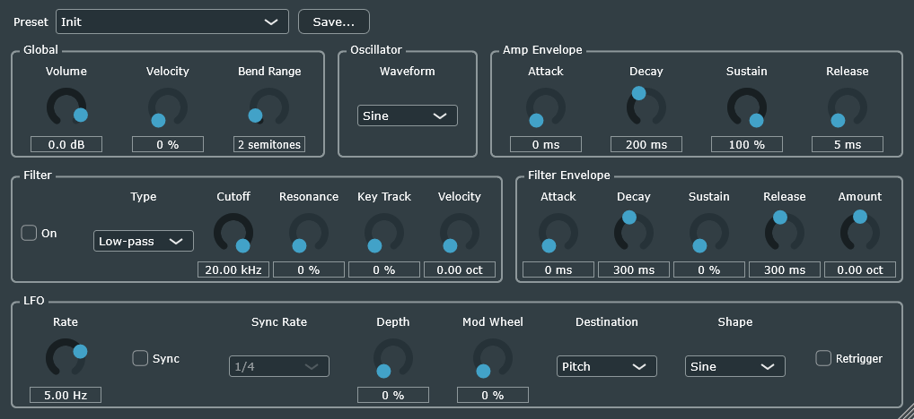

# BoringSynth

A minimal VST3 instrument plug-in. Press a key and it plays a waveform (sine, triangle, saw or square) at that key's pitch, shaped over time by an ADSR envelope and, if you switch it on, a resonant filter (low-pass, high-pass or band-pass). An LFO can add vibrato, tremolo or a filter wobble. By default, a note starts at full level and stops 5 ms after you release the key. Its window is suitably plain: JUCE's standard knobs, menus and tick boxes, in six labelled groups, with a preset menu along the top. It can play up to 16 notes at once; a 17th takes over the voice of an earlier note, which fades out over 5 ms rather than clicking. The pitch wheel bends notes, the mod wheel can deepen the LFO, and the sustain pedal holds notes after you release the keys. Other MIDI controllers, including the sostenuto and soft pedals, are ignored.

It has twenty-seven parameters. The plug-in's window shows them all, and your DAW can show them in its own controls too. All of them can be automated and are saved with your project. Drag the window's bottom-right corner to make it bigger or smaller (75 % to 200 %); your project remembers its size.



Each knob shows its value underneath; drag it up or down (or round), double-click it to go back to its default, or click the value to type one. LFO Rate is greyed out while LFO Sync is on, and LFO Sync Rate while it's off, since only one of them sets the LFO's speed.

- **Volume**, from -inf (silence) to +6 dB, default 0 dB. Changes glide over 20 ms, so fast moves and automation don't crackle.
- **Velocity Sensitivity**, from 0 to 100 %, default 0 %. At 0 % every note plays at the same level however hard you hit the key. At 100 %, a note's level follows the standard General MIDI curve, (velocity / 127)², so velocity 64 is about 12 dB quieter. The hardest hit (velocity 127) is always full level. A note's level is set when it starts, so changing the sensitivity affects the next notes you play, not ones already sounding.
- **Pitch Bend Range**, from 0 to 24 semitones, default 2. How far the pitch wheel bends notes, up or down. At 0 the wheel is ignored. Bends glide over 10 ms, so a keyboard that sends the wheel in coarse steps still bends smoothly. A note bent above half the sample rate (where it would distort) goes silent until it's bent back down.
- **Waveform**: Sine (the default), Triangle, Saw or Square. All four are matched in loudness and band-limited, so even the highest notes stay clean instead of picking up harsh, unrelated tones (aliasing). Changing it during a note fades to the new waveform over 10 ms rather than clicking.
- **Amp Attack, Amp Decay, Amp Sustain, Amp Release**: the envelope that shapes each note's level. Attack is how long a note takes to rise to full level (0 to 10 s, default 0: instant). Decay is how long it then takes to fall to the sustain level (5 ms to 10 s, default 200 ms). Sustain is the level it holds while the key is down (0 to 100 %, default 100 %). Release is how long it takes to fade out after the key is released (5 ms to 10 s, default 5 ms). The time knobs are skewed so their middle is half a second, giving most of their travel to short times. Changes apply to notes already playing; a change of sustain level glides over 20 ms.
- **Filter, Filter Type, Filter Cutoff, Filter Resonance, Filter Key Tracking**: a filter on each note. It's off by default; switching it on or off during a note crossfades over 10 ms. The type is Low-pass (the default), which removes frequencies above the cutoff (the classic synth "wah" when you sweep it); High-pass, which removes those below it, thinning the sound out; or Band-pass, which keeps a band around the cutoff and removes both sides, for a nasal, hollow sound. Changing the type during a note crossfades over 10 ms too. Cutoff runs from 20 Hz to 20 kHz (default 20 kHz, fully open), on a knob where equal turns are equal steps in pitch. Resonance runs from 0 % (no peak) to 100 % (a +20 dB peak at the cutoff, for every type), default 0 %. Both glide over 20 ms when changed, so sweeps don't crackle, and every note starts with a clean filter. Key tracking (0 to 100 %, default 0 %) makes the cutoff follow the note you play: at 0 % the cutoff is the same for every note, so high notes sound duller than low ones; at 100 % it moves an octave for every octave you play, so every note keeps the same tone. The Cutoff knob sets the cutoff at middle C.
- **Filter Attack, Filter Decay, Filter Sustain, Filter Release, Filter Env Amount**: a second envelope, which moves each note's cutoff over time, starting afresh with every note. The amount is in octaves, from -8 to +8 (default 0, no effect): at the envelope's peak, the cutoff moves up (or, for negative amounts, down) by that many octaves from where Cutoff and key tracking put it. The envelope's stages work like the amp envelope's, and default to a "pluck": an instant attack, a 300 ms decay to 0 % sustain, and a 300 ms release. Try an amount of +3 to +4 octaves with a low cutoff for the classic plucked or "squelchy" synth bass.
- **Filter Velocity**, from 0 to 8 octaves, default 0 (velocity ignored). Makes softer notes darker: a note's cutoff is lowered by this many octaves times how far below full velocity it was played, so velocity 64 is lowered by about half the amount. The hardest hit (velocity 127) always gets the cutoff the knobs set, as with Velocity Sensitivity. It works on its own or together with Velocity Sensitivity, for notes that get both quieter and duller as you play softer. Like the level, it's set when each note starts.
- **LFO Rate, LFO Depth, LFO Destination, LFO Shape**: a low-frequency oscillator (a slow wave) that moves something about every note up and down. Rate runs from 0.05 to 20 Hz (default 5 Hz, a typical vibrato), on a knob whose middle is 1 Hz. Depth runs from 0 to 100 % (default 0 %, no effect); changes of depth glide over 20 ms. The destination is what it moves:
  - **Pitch** (the default): vibrato, by up to 12 × depth² semitones either way: about half a semitone at 20 %, 3 semitones at 50 % and a full octave at 100 %.
  - **Volume**: tremolo. The level swings between full and 1 − depth: at 50 % it dips to half level, at 100 % all the way to silence. It never goes above full level.
  - **Filter Cutoff**: a filter "wobble", moving the cutoff by up to 4 × depth octaves either way: two octaves at 50 %, four at 100 %. It only does anything while the filter is on.

  The shape is Sine (the default), Triangle, Saw or Square, and every shape swings exactly from −1 to 1, so depth means the same for each. The saw rises steadily, then drops; the square holds at the top, then the bottom. Their instant jumps would click on the volume or the cutoff, so each jump is a straight 5 ms ramp, as short as the shortest release; at fast rates that makes the square slightly trapezoidal. Changing the destination or the shape during a note crossfades over 10 ms. There's one LFO for every note, running all the time, so a note you play joins it wherever it has got to, in step with any notes already sounding.
- **Mod Wheel LFO Depth**, from 0 to 100 %, default 0 % (the wheel ignored). How much the mod wheel adds to LFO Depth when it's fully up; halfway up adds half as much. So you can set the knob to no vibrato, or a little, and bring in more with the wheel as you play. The two together stop at 100 %. Wheel moves glide over 20 ms, like the knob, and the wheel works on any MIDI channel. MIDI "reset all controllers" puts it back down.
- **LFO Retrigger**: off by default, when the LFO runs freely and a note joins it wherever it has got to. Switched on, every note you play starts the LFO again from the beginning of its cycle, so each note's vibrato (or tremolo, or wobble) starts the same way. There's one LFO for all notes, so a new note restarts it for the notes already sounding too; the restart fades over 5 ms, so they don't jump.
- **LFO Sync, LFO Sync Rate**: Sync is off by default, when the LFO's speed is LFO Rate, in Hz. Switched on, LFO Rate is ignored and one cycle of the LFO lasts the Sync Rate's note length at your DAW's tempo: 4/1 (four whole notes), 2/1, 1/1, 1/2., 1/2, 1/2T, 1/4., 1/4 (the default), 1/4T, 1/8., 1/8, 1/8T, 1/16., 1/16, 1/16T or 1/32, where "." is dotted (half as long again) and "T" a triplet (two thirds as long). They're note lengths, not bars: in 3/4 time, 1/1 lasts a bar and a third. While the song plays, the LFO also follows the song's position, so it lines up with the beat the same way every time you play or export; if the song loops or you jump around it, the LFO fades to its new position over 5 ms. While stopped it runs freely at the tempo, and if your DAW gives no tempo it uses 120 BPM. With Retrigger on as well, notes restart the LFO instead, and it runs at the synced speed from there. It never runs faster than 50 Hz, which only 1/32 above 375 BPM would.

## Presets

The preset menu at the top of the window lists the factory presets, then your own:

- **Factory presets**, built into the plug-in: **Init** (every setting at its default, the plug-in's first sound), Soft Pad, Pluck Bass, Squelch, Tremolo Organ, Wobble Bass, Vibrato Lead (move the mod wheel), Chopped Chords (in time with your song) and Sub Bass (a pure sine). Your DAW also lists them as the plug-in's programs, followed by one more, **(User preset)**, which your DAW shows while you're on anything else, such as one of your own presets; choosing it changes nothing.
- **Your presets**: **Save...** asks for a name and saves the current settings, asking first before replacing one with the same name. They're saved in `Documents\BoringSynth\Presets` (the folder is made when you first save one), one file per preset, named after it. To rename or delete one, rename or delete its file; the menu re-reads the folder each time it opens.

A preset file is the same as the settings the plug-in saves in your project: readable XML listing each parameter's value. A preset saved before a parameter existed loads with that parameter at its default. Your project also remembers which preset it was on. Your DAW's own preset system (FL Studio's `.fst` files, or `.vstpreset` in other hosts) works as well, since it saves the same settings.

It's built with [JUCE](https://juce.com) 9.0.3 and CMake. The code is in `src`:

| File | What it does |
|------|--------------|
| [`BoringSynthProcessor`](src/BoringSynthProcessor.cpp) | The plug-in itself: the audio callback, the Volume control, the output safety check, saving and loading settings, and its window |
| [`BoringSynthEditor`](src/BoringSynthEditor.cpp) | The plug-in's window: a control for every parameter, laid out in groups |
| [`Parameters`](src/Parameters.cpp) | Every parameter's ID, range, default and display text |
| [`PresetManager`](src/PresetManager.cpp) | Loading and saving presets, and keeping track of the current one |
| [`FactoryPresets`](src/FactoryPresets.cpp) | The built-in presets, from Init on |
| [`Synth`](src/Synth.cpp) | JUCE's synthesiser, which turns MIDI into notes, with the sostenuto pedal switched off, plus the LFO every note shares |
| [`SynthVoice`](src/SynthVoice.cpp) | One playing note: its pitch, pitch bend, vibrato, velocity, filter and amp envelope |
| [`Envelope.h`](src/Envelope.h) | The ADSR envelope: a note's level over time |
| [`Filter.h`](src/Filter.h) | The resonant state-variable filter |
| [`Oscillator.h`](src/Oscillator.h) | The waveform itself, one sample at a time, read from a wave table |
| [`Lfo.h`](src/Lfo.h) | The LFO's wave, one sample at a time, in any of the four shapes, with the saw's and square's jumps turned into 5 ms ramps |
| [`Waveforms`](src/Waveforms.cpp) | The four waveforms' shapes, their loudness matching, and the tables built from them |
| [`BandLimitedWaveTable`](src/BandLimitedWaveTable.cpp) | A waveform as a ladder of wave tables with fewer and fewer high harmonics (built with an FFT), so each note reads one that doesn't alias |
| [`WaveTable`](src/WaveTable.cpp) | One cycle of a waveform, stored as 2048 samples and read with interpolation; built once when the plug-in loads |

Before changing how it works, read [`docs/DESIGN.md`](docs/DESIGN.md). It covers how the pieces fit together, the identifiers that must never change, the real-time rules, and why the main decisions were made. The plan for what comes next is in [`docs/ROADMAP.md`](docs/ROADMAP.md), and the maths behind the sound (pitch, aliasing, band-limiting, RMS, the filter, the LFO) is explained in [`docs/MATH.md`](docs/MATH.md).

## How to build the plug-in

### 1. Install the tools

You need:

- **Git**: https://git-scm.com/downloads
- **CMake 3.22 or later**: https://cmake.org/download/ (on Windows, choose the option to add CMake to the PATH during installation)
- **A C++ compiler**:
  - **Windows:** [Visual Studio](https://visualstudio.microsoft.com/) 2022 or later. The free Community edition is fine. In the Visual Studio Installer, tick the **Desktop development with C++** workload.
  - **macOS:** Xcode from the App Store, then run `xcode-select --install` in Terminal.
  - **Linux:** see [Building on Linux](#building-on-linux) below.

To check that Git and CMake are installed, open a terminal (PowerShell on Windows, Terminal on macOS) and run:

```bash
git --version
cmake --version
```

Both should print a version number.

### 2. Download the code

JUCE is included as a git submodule, which is a link to JUCE's own repository. The `--recursive` option downloads it too. JUCE is large, so this can take a few minutes.

```bash
git clone --recursive https://github.com/christj6/vstTest.git
cd vstTest
```

If you already cloned without `--recursive`, the `libs/JUCE` folder will be empty. Fix that with:

```bash
git submodule update --init --recursive
```

### 3. Build

#### Building on Windows

Run these from the `vstTest` folder:

```bash
cmake -B build
cmake --build build --config Release --target BoringSynth_VST3
```

The first command generates a Visual Studio project in the `build` folder, using the newest Visual Studio installed. It takes a few minutes the first time. The second command compiles the plug-in.

The finished plug-in is at:

```
build\BoringSynth_artefacts\Release\VST3\BoringSynth.vst3
```

If you'd rather work in the Visual Studio IDE, open the solution file in the `build` folder after the first command (`BoringSynth.slnx` with Visual Studio 2026, `BoringSynth.sln` with Visual Studio 2022), choose **Release** in the toolbar, and build the **BoringSynth_VST3** project.

#### Building on macOS

> Not yet tested on macOS. These are the standard JUCE/CMake steps.

```bash
cmake -B build -G Xcode -D"CMAKE_OSX_ARCHITECTURES=arm64;x86_64"
cmake --build build --config Release --target BoringSynth_VST3
```

The plug-in is at `build/BoringSynth_artefacts/Release/VST3/BoringSynth.vst3`. You can also open `build/BoringSynth.xcodeproj` in Xcode and build the **BoringSynth_VST3** target there.

#### Building on Linux

> Not yet tested on Linux. These are the standard JUCE/CMake steps for Ubuntu.

Install a compiler, the build tools, and the libraries JUCE needs:

```bash
sudo apt update
sudo apt install build-essential ninja-build libasound2-dev libjack-jackd2-dev ladspa-sdk libfontconfig1-dev libfreetype-dev libx11-dev libxcomposite-dev libxcursor-dev libxext-dev libxinerama-dev libxrandr-dev libxrender-dev libxi-dev
```

The package list comes from JUCE's [`docs/Linux Dependencies.md`](libs/JUCE/docs/Linux%20Dependencies.md). Package names can differ on other distributions.

Then build:

```bash
cmake -B build -G "Ninja Multi-Config"
cmake --build build --config Release --target BoringSynth_VST3
```

The plug-in is at `build/BoringSynth_artefacts/Release/VST3/BoringSynth.vst3`.

### Debug vs. Release

Replace `Release` with `Debug` in the build command for a build that is easier to step through in a debugger, but slower. The output then goes to `build/BoringSynth_artefacts/Debug/...` instead.

## Running the tests

The `tests` folder has a small test program, `Tests`. Its render tests play MIDI into the plug-in's audio code and check what comes out. The note tests cover levels, silence for notes the sample rate can't represent, no NaN output, the sustain pedal, note timing, voice stealing, and that the output doesn't depend on the host's block size. The control tests cover Volume, Velocity Sensitivity and pitch bend. The sound tests cover Waveform, the amp envelope and the filter, including its key tracking, envelope and velocity amount. The LFO tests cover vibrato (its depth and rate), tremolo sample by sample, the filter wobble, each shape, one LFO shared by every note and running between them, depth, destination and shape changes gliding, the mod wheel adding depth, retriggering, tempo sync (following the tempo, locking to the song, fading when it jumps), and block-size independence; and the LFO's shapes on their own, including that they swing exactly from -1 to 1 and that their jumps take 5 ms. Its parameter tests check that parameters keep the IDs saved projects rely on, and that the plug-in's settings survive saving and reloading. Its editor tests check that the plug-in's window opens, closes and opens again, and makes no difference to the sound; that every parameter has one control of the right kind, connected both ways and showing the parameter's value text; that the controls fit in the window without overlapping, at 75 %, 100 % and 200 %, and every row of groups ends at the same place; that the window resizes only between 75 % and 200 %, keeping its shape and drawing everything to scale; that it reopens at its size, which the project remembers (old projects open at 100 %, impossible sizes are brought within the limits) and presets leave alone; and that the preset menu works. Its preset tests check the factory presets (Init sounds exactly like a new plug-in), saving and loading your own (in a temporary folder, never your Documents), presets from older versions and files that aren't presets, the preset saved with a project, and the factory presets as programs (including choosing Init from the host after one of your own). Its render tool tests check that `--render` writes exactly what the plug-in plays, and refuses files, presets or parameters it doesn't know. Its reference render tests check that `--compare` passes an unchanged render and fails a changed one, or one changed by more than the tolerance given. Its oscillator tests check the wave tables and oscillator on their own, against `std::sin` and for aliasing, so any loss of accuracy shows up as a number. Its envelope tests check each stage of the envelope sample by sample, including the cases that would click. Its filter tests check each filter type's frequency response against the textbook one, its resonance, and that it stays stable however fast it's swept. Build it and run it with CTest, which comes with CMake:

```bash
cmake --build build --config Release --target Tests
ctest --test-dir build -C Release --output-on-failure
```

It prints `PASS` or `FAIL` for each check. CTest reports the whole program as failed if any check fails. Run the tests after every change to the plug-in.

### Checking that a change doesn't alter the sound

The test program can also record a fixed three-second render that exercises everything the plug-in does, and later compare against it. Record before making a change:

```bash
build/tests/Tests_artefacts/Release/Tests --record build/reference.bin
```

Then make the change, rebuild, and compare:

```bash
build/tests/Tests_artefacts/Release/Tests --compare build/reference.bin
```

It reports, for each part of the render, either `identical` or the largest difference in dBFS. A change meant to keep the sound the same (a refactor, a new feature at its default setting) should be identical, or within a tiny amount when the change is meant to be inaudible. Any difference makes it exit with a failure, so a script can rely on it; to allow a tiny one, give the largest allowed difference in dBFS after the file name:

```bash
build/tests/Tests_artefacts/Release/Tests --compare build/reference.bin -120
```

The recording is only valid on the machine and build that made it, so it lives in `build/` and isn't committed.

### Checking that a change doesn't slow it down

The test program can also time the plug-in, playing through the same audio callback a DAW calls:

```bash
build/tests/Tests_artefacts/Release/Tests --benchmark
```

For seven cases (no notes, 16 sine notes, 16 saw notes with the pitch wheel moving, 16 saw notes through the filter with its cutoff moving, 16 saw notes through the filter envelope, 16 saw notes with vibrato, and 16 saw notes with the LFO moving the filter cutoff), it reports how many times faster than real time the plug-in runs, and how much of each audio block's time budget it uses. Use the Release build, and compare runs on the same computer: the numbers vary by machine and by a few percent between runs.

### Looking at the window without a DAW

The test program can draw the plug-in's window to a PNG file, which is how [`docs/editor.png`](docs/editor.png) is made. Run it again after changing the layout. Add a display scale after the file name (`2`, say) to see the window as a high-DPI display shows it, at 200 %:

```bash
build/tests/Tests_artefacts/Release/Tests --snapshot docs/editor.png
```

### Reproducing what you heard in your DAW

The test program can play a MIDI file through the plug-in with one of its factory presets, and write what comes out to a WAV file (44.1 kHz, 32-bit float). Export the notes from your DAW as a MIDI file, then:

```bash
build/tests/Tests_artefacts/Release/Tests --render notes.mid out.wav "Chopped Chords"
```

The host plays at the MIDI file's tempo, from the start of the song. After the preset's name you can change any of its parameters, each as `parameterId=value` in the parameter's own units, for example `filterCutoff=1500 lfoDepth=50` (the IDs are listed in [`docs/DESIGN.md`](docs/DESIGN.md)). It's how a click heard in FL Studio was tracked down: the render matched the recording to 0.99999, apart from FL's channel volume.

## Checking commits for secrets

The repo includes a Git hook, [`.githooks/pre-commit`](.githooks/pre-commit), that scans each commit for secrets (API keys, tokens, private keys) with [gitleaks](https://github.com/gitleaks/gitleaks) and blocks the commit if it finds one. To use it, install gitleaks (Windows: `scoop install gitleaks`, macOS: `brew install gitleaks`), then turn the hook on once in your clone:

```bash
git config core.hooksPath .githooks
```

If gitleaks reports something that isn't really a secret, see its documentation for how to allow it. If something real ever does reach GitHub, revoke or replace it right away. Removing it in a later commit doesn't help, because it stays in the history.

## How to install the plug-in

The build does not install the plug-in. Copy the whole `BoringSynth.vst3` folder (on Windows it's a folder, not a single file) to your system's VST3 folder:

| System  | VST3 folder |
|---------|-------------|
| Windows | `C:\Program Files\Common Files\VST3` (needs administrator rights) |
| macOS   | `/Library/Audio/Plug-Ins/VST3` or `~/Library/Audio/Plug-Ins/VST3` |
| Linux   | `~/.vst3` |

Then rescan plug-ins in your DAW and look for **Jack > BoringSynth**. It's an instrument, so load it where you'd load a synth.

**FL Studio on Windows:** FL only finds VST3 plug-ins in `C:\Program Files\Common Files\VST3`. Adding the build folder as a custom search path doesn't work, because FL only scans custom paths for VST2 plug-ins. Go to **Options > Manage plugins > Find installed plugins** to rescan.

### Tip for development on Windows: link instead of copying

If you're changing the code and rebuilding often, you can make a *junction* (a folder shortcut) in the VST3 folder that points at your build output. Then every rebuild shows up in your DAW without copying. Run this once in PowerShell **as administrator** (right-click PowerShell > Run as administrator), changing the second path to wherever you cloned the repo:

```bash
New-Item -ItemType Junction -Path "C:\Program Files\Common Files\VST3\BoringSynth.vst3" -Target "C:\path\to\vstTest\build\BoringSynth_artefacts\Release\VST3\BoringSynth.vst3"
```

Close the plug-in in your DAW before rebuilding, because Windows won't let the build overwrite a file that's in use. Rescan afterwards if the DAW doesn't pick up the change.

## Troubleshooting

- **`libs/JUCE` is empty, or CMake says it can't find `libs/JUCE`:** the submodule wasn't downloaded. Run `git submodule update --init --recursive`.
- **`No CMAKE_CXX_COMPILER could be found` (Windows):** Visual Studio's C++ tools aren't installed. Open the Visual Studio Installer, click **Modify**, and tick **Desktop development with C++**.
- **`'cmake' is not recognized`:** CMake isn't on your PATH. Reinstall it and choose the PATH option, or close and reopen the terminal after installing.
- **The build fails with "cannot open file ... BoringSynth.vst3" or "access denied":** the plug-in is loaded in your DAW. Close it there (or close the DAW) and build again.
- **The plug-in doesn't show up in the DAW:** check that the whole `BoringSynth.vst3` folder is in the VST3 folder listed above, then rescan.
- **Weird errors after changing CMake settings or Visual Studio versions:** delete the `build` folder and run both commands again.

## Code style

The code follows the [JUCE coding standards](https://juce.com/blog/coding-standards/).
